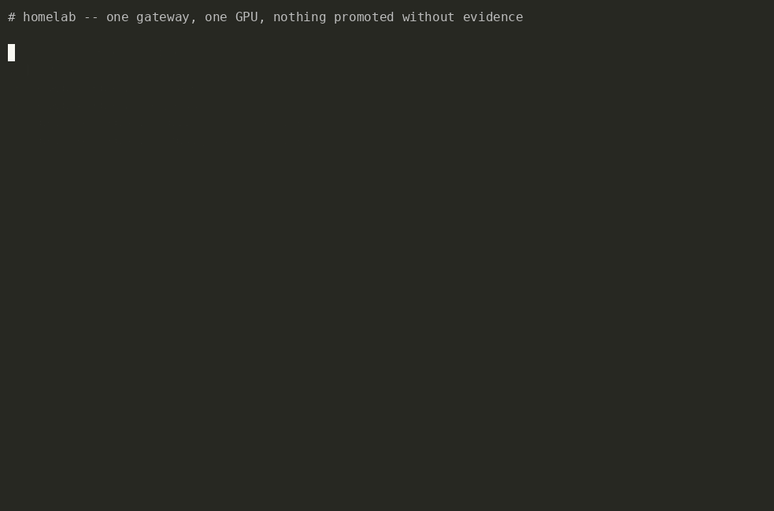
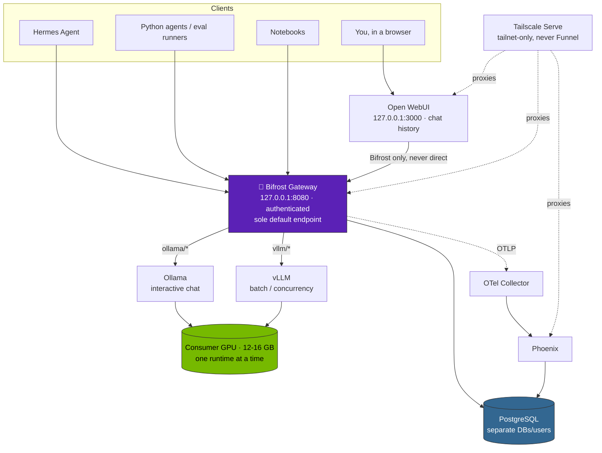

<div align="center">

# 

**A local-first LLM workstation and on-demand server for a single Ubuntu Desktop.**
One consumer GPU. One gateway. Zero silent cloud calls.

[](pyproject.toml)
[](https://docs.astral.sh/uv/)
[](compose.yaml)
[](docs/models.md)
[](docs/adrs/0001-bifrost-as-default-gateway.md)
[](docs/adrs/0001-bifrost-as-default-gateway.md)
[](LICENSE)

</div>

<p align="center">
  <em>Ollama for interactive chat. vLLM for batch. Bifrost as the one door in. Phoenix watching everything.<br/>
  Nothing gets promoted to default on a hunch — every candidate earns it with a checksummed bundle or it doesn't ship.</em>
</p>

---

> [!NOTE]
> **This isn't aspirational.** Every claim below has been exercised end-to-end on real hardware — an Ubuntu 24.04 desktop with a consumer-grade NVIDIA GPU (e.g., RTX 5070 Ti with 16GB VRAM) — not just unit-tested offline. GPU passthrough into containers, all four core services healthy, Bifrost authentication enforced, `qwen3.5:9b` pulled and loaded, and one streaming + one non-streaming completion traced all the way into Phoenix. A cluster of real Docker-networking and Bifrost bugs turned up doing that, each fixed and documented in [ADRs 0010–0013](#-decision-log). See [`docs/verification-report.md`](docs/verification-report.md) for the full picture.

## See it work

The daily loop, recorded for real against a running stack — start the GPU services, confirm everything's healthy, send a real completion through Bifrost, then give the GPU back:



<!-- TODO: Open WebUI chat screenshot — swap in once captured -->

## Table of contents

**Quick start:** [One-time setup](#-one-time-setup) · [Daily driver](#-daily-driver) · [Talking to the model](#-talking-to-the-model)

<details>
<summary><strong>Complete contents</strong></summary>

- [See it work](#-see-it-work)
- [Why this exists](#why-this-exists)
- [Highlights](#-highlights)
- [Architecture](#architecture)
- [One-time setup](#-one-time-setup)
- [Daily driver](#-daily-driver)
- [Where to look](#-where-to-look)
- [Talking to the model](#-talking-to-the-model)
- [Model matrix](#-model-matrix)
- [Command reference](#-command-reference)
- [Evaluation & acceptance workflow](#-evaluation--acceptance-workflow)
- [Design & safety highlights](#-design--safety-highlights)
- [Decision log](#-decision-log)
- [Repository layout](#-repository-layout)
- [Development](#-development)
- [Remote access & storage](#-remote-access--storage)
- [Contributing](#contributing)
- [License](#license)

</details>

## Why this exists

Most "local LLM" setups are `ollama run` plus a chat UI, and that's the whole architecture — no gateway, no audit trail, no answer to "why is *this* the default model" beyond "it started successfully." That's fine for a toy. It's not fine for something you route agents, tools, and other people's chats through.

`serveshed` is what that setup looks like with governance actually built in: **one authenticated gateway** every caller goes through — no agent, script, or UI ever talks to Ollama or vLLM directly — **evidence before promotion**, where a model becomes the default only after a checksummed evaluation bundle and a checksummed benchmark bundle both clear explicit thresholds, and **immutable, tamper-evident runs**, where every eval, benchmark, and acceptance decision is SHA-256-manifested and verifiable after the fact. Layered on top of the parts every setup needs anyway: the desktop stays a desktop (GPU release is one command, verified against `nvidia-smi`, not assumed), and nothing reaches the internet by default — no cloud fallback exists to reach, enforced by network isolation and a static check, not a promise in a doc.

## Highlights

- **One gateway, always** — [Bifrost](https://docs.getbifrost.ai/) is the sole authenticated OpenAI-compatible endpoint. No agent, script, or notebook talks to Ollama or vLLM directly.
- **A real chat UI, not just curl** — Open WebUI, with history, comes up with `up chat`. It's a Bifrost client like any other — same governance, same tracing, no side door to Ollama.
- **GPU inference is a light switch** — `serveshed up chat` / `up eval` / `gpu-off`. Ollama and vLLM are mutually exclusive by construction; releasing the GPU is one command, verified to actually free VRAM.
- **Evidence, not vibes, promotes a model** — `model accept` requires a checksummed evaluation bundle *and* a checksummed benchmark bundle for the same alias, explicit pass/latency/throughput thresholds, and blocks `.env` promotion the moment any threshold fails.
- **Immutable, tamper-evident runs** — every eval, benchmark, and acceptance decision writes a SHA-256-manifested bundle. Verification rejects mismatches, missing files, symlinks, and path traversal before a bundle is trusted.
- **Content logging is a deliberate, documented choice, not a default nobody looked at** — currently on for all traffic ([ADR 0016](docs/adrs/0016-content-logging-enabled-by-default.md); Bifrost has no per-key content scoping, so this applies to every caller). It defaulted to hidden-by-default before that; either way, it's one config value, one static test asserting it matches what's declared, and treated as sensitive data either way.
- **No silent cloud route — enforced, not promised** — no default cloud provider exists in the config. [LiteLLM](https://www.litellm.ai/) sits fully isolated on its own port purely as a future comparison candidate against Bifrost — nothing in this stack routes through it — and a static check fails the build the moment anything chains it through Bifrost anyway.
- **Fail-closed backups** — Synology writes happen only when the mount is real *and* a reviewed marker file is present. A dangling mount point never silently fills your root disk.
- **Hardware-aware model registry** — recommendations are ranked against your actual detected VRAM/RAM, not a model card's advertised context window.
- **Dependency-free bootstrap** — the control plane is standard-library Python, `uv`-managed, with 76 offline tests and 30 static architecture checks that run without Docker or a network connection.
- **Every non-obvious call is an ADR** — [19 of them](#-decision-log) so far, several written the same day the bug they fix was found on real hardware.

## Architecture



Ollama and vLLM are never kept active together: `serveshed up chat` stops vLLM first, `serveshed up eval` stops Ollama first, and `serveshed gpu-off` tears down both. Open WebUI isn't GPU-bound and isn't touched by `gpu-off` — it's a plain Bifrost client, same as any agent, just with a browser in front of it.

**Network isolation is real, not decorative.** The `backend` network (postgres, phoenix, otel-collector, bifrost, open-webui) has outbound internet access disabled at the Docker bridge level — not just app-level config — so there is no path for those services to reach the internet even if something tried. Only `ollama` and `vllm` sit on a second `egress` network for approved model downloads. Getting this right on real hardware took three fixes; see [ADR 0010](docs/adrs/0010-backend-network-no-egress-not-internal.md) and [ADR 0012](docs/adrs/0012-egress-gateway-priority.md) for exactly what broke.

Storage is two-tier: local NVMe holds everything live (models, databases, caches, current runs); an optional Synology NAS holds archives and backups later and never blocks startup.

## One-time setup

Everything in this section happens once per machine (or once after a `git pull` that changes dependencies). **This is not the daily workflow** — skip to [Daily driver](#-daily-driver) once you've done this a first time.

**Prerequisites:** Ubuntu Desktop, an NVIDIA GPU (12-16GB VRAM recommended) with a working driver, [`uv`](https://docs.astral.sh/uv/) installed.

```bash
git clone git@github.com:shirkattack/ServeShed.git serveshed && cd serveshed
uv sync --locked          # dependency-free bootstrap, no package index needed
uv run serveshed init       # generates .env with fresh per-service secrets, mode 0600
uv run serveshed doctor     # read-only host check: python, docker, GPU, disk, ports…
uv run serveshed config validate
```

Then, once Docker Engine + NVIDIA Container Toolkit are installed (see [`docs/runbook.md`](docs/runbook.md) if you need to set those up):

```bash
uv run serveshed config validate --docker   # authoritative Compose render
uv run serveshed model recommend --workload agents
uv run serveshed model pull local/qwen-fast   # ~6.6 GiB, one-time download, explicit confirmation required
```

That's it — the model is cached on local NVMe (`$SERVESHED_DATA_DIR/ollama`) from here on. You won't hit the network again for it unless you pull a different one.

Dry-run anything before it touches your machine:

```bash
uv run serveshed up chat --dry-run
uv run serveshed gpu-off --dry-run
```

## Daily driver

This is the loop you actually run every time you sit down to use the model — no re-pulling, no re-initializing.

```bash
uv run serveshed up chat      # starts postgres, phoenix, otel-collector, bifrost, ollama, AND open-webui
uv run serveshed status       # confirm bifrost + phoenix are reachable, GPU is where you expect
```

`up chat` brings the *entire* stack up — you don't need `up core` first; `chat` already includes it (see [`PROFILE_SERVICES`](src/serveshed/compose.py)). One command, one thing to remember. Then open **http://127.0.0.1:3000** for a chat UI with history, or use any of the other options below.

...then [talk to the model](#-talking-to-the-model) however you like...

...and when you're done, give the GPU back:

```bash
uv run serveshed gpu-off      # unloads the model, stops ollama + vllm — verify with `nvidia-smi`
```

`gpu-off` alone is usually enough day-to-day — it leaves Bifrost/Phoenix/Postgres running so traces and history stick around cheaply in the background (they don't touch the GPU). Run `uv run serveshed down` on top of that if you want the containers themselves stopped too — nothing is ever lost either way; `down` never deletes volumes.

<table><tr><td>

**TL;DR — the two commands that matter most, day to day:**
```bash
uv run serveshed up chat   # start of session
uv run serveshed gpu-off   # end of session
```

</td></tr></table>

## Where to look

Phoenix's UI, Bifrost's own UI, and where the logs live:

| What | Where | Needs |
|---|---|---|
| **Open WebUI** — chat with history, model picker, per-person accounts | **http://127.0.0.1:3000** in a browser | `up chat` running; sign up — new accounts start `pending` until an existing admin approves them from Admin Panel → Users |
| **Phoenix** — every trace, prompt, response, latency, token count | **http://127.0.0.1:6006** in a browser | `up core`/`up chat` running |
| **Bifrost's own dashboard** — providers, virtual keys, governance, live request log | **http://127.0.0.1:8080** in a browser | `BIFROST_ADMIN_USERNAME` / `BIFROST_ADMIN_PASSWORD` from `.env` |
| **Bifrost logs** (raw, structured JSON, one line per request) | `uv run serveshed logs bifrost` | — |
| **Every service's logs** at once | `uv run serveshed logs` | — |
| **Live-tail while you work** | `uv run serveshed logs bifrost --follow` | — |
| **Ollama's own state** — what's loaded, CPU/GPU split | `uv run serveshed status` or `uv run serveshed model inventory` | `up chat` running |

Phoenix is the one to leave open in a tab — it's where you actually see what a request looked like: the full prompt, the full response, token usage, latency, routing, and errors. Content logging is on by default for all traffic ([ADR 0016](docs/adrs/0016-content-logging-enabled-by-default.md)) — treat this database as sensitive, same as you would any chat history.

## Talking to the model

**With chat history — Open WebUI:** open **http://127.0.0.1:3000** and sign up (multi-account mode, ADR 0015). The very first account ever created is admin; every signup after that starts as `pending` until an admin approves it from Admin Panel → Users — including family members you invite later. Pick a model (only the ones allow-listed for it show up — `local/qwen-fast`, `local/qwen-quality`, `local/gemma-judge`), and chat. It's a plain Bifrost client under the hood — every conversation still traces into Phoenix like anything else. This is the one to reach for day to day, and the one to hand to family members once their account is approved and you've reached them over Tailscale (see [Remote access & storage](#-remote-access--storage)).

**Quickest, no UI — curl straight at Bifrost, OpenAI-compatible:**

```bash
VK=$(grep '^BIFROST_VK_HERMES=' .env | cut -d= -f2)
curl http://127.0.0.1:8080/v1/chat/completions \
  -H "Authorization: Bearer $VK" -H "Content-Type: application/json" \
  -d '{"model":"ollama/local/qwen-fast","messages":[{"role":"user","content":"Explain local-first in one sentence."}]}'
```

**Dependency-free Python client** (bundled in [`examples/`](examples/), routes through Bifrost, tags the request with a distinct virtual-key identity):

```bash
uv run python examples/simple_client.py "Explain local-first in one sentence."
uv run python examples/simple_client.py --agent coding "Write a Python function that reverses a linked list."
```

**Point any OpenAI-compatible tool/library at it** — same pattern everywhere: base URL `http://127.0.0.1:8080/v1`, API key = one of the `BIFROST_VK_*` values from `.env`, model = a gateway alias like `ollama/local/qwen-fast`.

### Example use cases

- **Everyday chat, with history** — Open WebUI, for anything you'd otherwise reach for a hosted chat UI to do.
- **Scripted Q&A / drafting** — `examples/simple_client.py`, or the curl one-liner above, when you want it in a shell pipeline instead of a browser.
- **Coding assistant, tool-free** — `--agent coding` gives the request its own virtual key and trace identity, so Phoenix cleanly separates "coding" traffic from everything else even though it's the same model.
- **A sequential multi-agent pipeline** — `uv run python examples/multi_agent_pipeline.py "Design a local document ingestion test"` runs research → implementation → critique as three calls with distinct agent identities and a shared session ID, deliberately sequential because one GPU serves one loaded model at a time.
- **Point Hermes Agent or any OpenAI-SDK agent framework at it** — set its base URL to `http://127.0.0.1:8080/v1` and use the `BIFROST_VK_HERMES` key; every call still gets governed, traced, and privacy-scoped exactly like the examples above.
- **A cross-family judge pass** — after generating and saving outputs from `local/qwen-fast`, unload it (`gpu-off`), then load `local/gemma-judge` and grade the saved outputs in a separate phase — see [`docs/evals.md`](docs/evals.md) for the full single-GPU judge workflow.

## Model matrix

`config/models/registry.yaml` is the single source of truth; everything else (recommendations, Bifrost aliases, static checks) derives from it.

> **Note:** Multiple Qwen variants serve different purposes—`fast` for daily use, `quality` for precision work, `batch` for concurrent operations, and experimental variants for testing specific optimizations (quantization methods, CPU offload, refusal ablation).

### Production models

<!-- BEGIN GENERATED MODEL MATRIX (scripts/generate-model-matrix.py) -->
| Alias | Runtime | Role | Status |
|---|---|---|---|
| `local/qwen-fast` | Ollama | Default daily model for chat, coding, tools, multimodal tasks, and routine evaluations | Measurement approved — **default** |
| `local/qwen-quality` | Ollama | Higher-precision Qwen comparison for quality-sensitive local work | Measurement approved |
| `local/qwen-batch` | vLLM | Concurrent agents and batch evaluation generation after a quantized vLLM artifact is accepted | Review-gated |
| `local/gemma-judge` | Ollama | Different-family local judge and multimodal comparison model | Measurement approved |
| `local/embed` | Ollama | Embeddings for future RAG and semantic evaluation | Review-gated |

### Experimental models

<details>
<summary><strong>Show experimental variants</strong></summary>

| Alias | Runtime | Role | Status |
|---|---|---|---|
| `experimental/qwen-nvfp4` | Ollama | Blackwell-oriented Qwen quantization candidate for quality and speed comparison | Experimental, Measurement approved |
| `experimental/qwen-abliterated` | Ollama | Refusal-ablated Qwen3.5-9B for research/creative use where default refusal behavior gets in the way; never used as a judge or eval grader | Experimental, Measurement approved |
| `experimental/hermes-agent` | Ollama | Hermes-focused tool-use, structured-output, and agent compatibility challenger | Experimental, Review-gated |
| `experimental/qwen38-offload` | Ollama | Occasional Qwen3.8 quality comparison using partial CPU offload | Experimental, Measurement approved |

</details>
<!-- END GENERATED MODEL MATRIX -->

Regenerate after any registry change: `uv run python scripts/generate-model-matrix.py` (`./scripts/check.sh` fails if it's stale).

Artifact size is never treated as VRAM usage — context, KV cache, runtime buffers, and the desktop compositor all compete for the available VRAM (typically 12-16 GB on consumer GPUs). See [`docs/models.md`](docs/models.md) for the full provenance and measurement policy.

## Command reference

<details>
<summary><strong>Lifecycle & host</strong> — <code>init · doctor · status · up · down · gpu-off · logs</code></summary>

```bash
uv run serveshed init                 # generate .env + local directories
uv run serveshed doctor               # read-only host readiness report
uv run serveshed doctor --json        # same, machine-readable
uv run serveshed status               # services, GPU, Ollama model, NAS state
uv run serveshed up core              # postgres, phoenix, otel-collector, bifrost
uv run serveshed up chat              # + ollama (stops vllm first)
uv run serveshed up eval              # + vllm (stops ollama first, requires SERVESHED_ENABLE_VLLM=true)
uv run serveshed gpu-off              # unload models, stop ollama + vllm
uv run serveshed down                 # stop everything; never deletes volumes
uv run serveshed logs [service]       # tail Compose logs
```
</details>

<details>
<summary><strong>Models</strong> — <code>list · show · recommend · pull · inventory · select · accept</code></summary>

```bash
uv run serveshed model list
uv run serveshed model show local/qwen-fast
uv run serveshed model recommend --workload agents
uv run serveshed model recommend --vram-gib 16 --workload coding --tools
uv run serveshed model pull local/qwen-fast
uv run serveshed model inventory                          # installed vs. registry
uv run serveshed model select local/qwen-fast --execute    # manual override, backs up .env
uv run serveshed model accept \
  --eval-run <dir> --benchmark-run <dir> \
  --min-pass-rate 1.0 --min-success-rate 1.0 \
  --min-tokens-per-second 20 --max-median-latency-ms 5000 \
  [--promote]
```
</details>

<details>
<summary><strong>Evaluation & benchmarking</strong> — <code>eval · benchmark · runs</code></summary>

```bash
uv run serveshed eval smoke --dry-run              # validate dataset, no network
uv run serveshed eval qwen --model local/qwen-fast # live run through Bifrost, eval-mode tracing
uv run serveshed eval promptfoo
uv run serveshed eval compare <run-a> <run-b>

uv run serveshed benchmark plan interactive --repetitions 3 --warmup 1
uv run serveshed benchmark run throughput --model local/qwen-fast
uv run serveshed benchmark compare <run-a> <run-b>

uv run serveshed runs list --kind benchmark --model local/qwen-fast
uv run serveshed runs list --markdown
uv run serveshed runs verify <run-directory>       # checksum + tamper verification
```
</details>

<details>
<summary><strong>Remote access, storage & config</strong> — <code>tailscale · nas · backup · config</code></summary>

```bash
uv run serveshed tailscale plan          # prints commands, applies nothing
uv run serveshed nas status              # mount + marker check
uv run serveshed backup                  # dry-run
uv run serveshed backup --execute        # fail-closed: needs real mount + marker
uv run serveshed config validate         # 30 static architecture checks, offline
uv run serveshed config validate --docker  # + authoritative Compose render
```
</details>

## Evaluation & acceptance workflow

```text
plan (offline) → run (live, through Bifrost) → verify (checksum) → accept (thresholds) → promote (optional)
```

Every run — evaluation, benchmark, or acceptance decision — lands in its own immutable, checksummed bundle:

```text
$SERVESHED_DATA_DIR/eval-runs/
├── evaluations/<date>/<run-id>/{manifest,results,summary}.json + checksums.sha256
├── benchmarks/<date>/<run-id>/{manifest,samples,summary}.json  + checksums.sha256
└── acceptance/<date>/<run-id>/decision.json + sources/{evaluation,benchmark}/… + checksums.sha256
```

Warmups stay in raw benchmark data but never touch the aggregates. `--limit` runs still archive the *exact* selected input, with separate digests for the full source dataset and the selected subset — so a rerun and a re-decision can always be traced back to precisely what ran. `model accept` will not promote a candidate whose bundle fails checksum verification, targets a different alias than expected, or misses any configured threshold — and every attempt, pass or fail, writes its own decision bundle. See [`docs/evals.md`](docs/evals.md).

## Design & safety highlights

A few decisions worth calling out specifically, because they're the parts most "local LLM" setups skip:

**The acceptance gate can't be talked into passing.** `model accept` cross-checks both source bundles' checksums, requires them to name the *same* registered alias, and only then evaluates thresholds — there's no code path that promotes on a starting-successfully basis alone. Promoting an `experimental/*` alias additionally requires an explicit override flag.

**Two Bifrost configs, kept in lockstep by a static test.** `config/bifrost/config.json` and `config.eval.json` are diffed with a normalization step for the one or two fields they're allowed to differ on — if anything else drifts between them, `config validate` fails. They're currently byte-identical (content logging is on in both, [ADR 0016](docs/adrs/0016-content-logging-enabled-by-default.md)); the swap mechanism stays in place for whatever, if anything, needs to differ between normal and eval runs next.

**The backend network genuinely cannot reach the internet.** Not `internal: true` (which, it turns out, also silently breaks host port publishing — confirmed by a live repro during this project's own bring-up) but a bridge network with IP masquerade explicitly disabled. Same isolation guarantee, without breaking the one thing that also needs to work: Bifrost and Phoenix answering on `127.0.0.1`.

**`gpu-off` is tested, not assumed.** On real hardware: Ollama stopped, vLLM stopped, `nvidia-smi` confirms zero VRAM held by any serveshed process before you go do something else with the GPU.

**Governance resolves to real access, not vibes.** Every Bifrost virtual key (Hermes, research, coding, eval, judge, Open WebUI) has its own key and an explicit `allowed_models` list; a static check fails if any allow-listed alias doesn't resolve to a configured provider alias.

## Decision log

Material architecture decisions live as ADRs in [`docs/adrs/`](docs/adrs/) — including the ones written the same day a bug was found and fixed on real hardware.

<details>
<summary><strong>All 19 ADRs</strong></summary>

| ADR | Decision | Status |
|---|---|---|
| [0001](docs/adrs/0001-bifrost-as-default-gateway.md) | Bifrost is the default gateway | accepted |
| [0002](docs/adrs/0002-phoenix-observability.md) | Phoenix and OpenTelemetry | accepted |
| [0003](docs/adrs/0003-manual-first-lifecycle.md) | Manual-first lifecycle | accepted |
| [0004](docs/adrs/0004-storage-tiers.md) | Local hot tier + optional Synology tier | accepted |
| [0005](docs/adrs/0005-qwen-quality-model.md) | Qwen3.8-27B as primary quality model | superseded by 0007 |
| [0006](docs/adrs/0006-image-version-policy.md) | Pin and verify container images | provisional |
| [0007](docs/adrs/0007-hardware-aware-model-matrix.md) | Hardware-aware model matrix | accepted for measurement |
| [0008](docs/adrs/0008-immutable-measurement-bundles.md) | Immutable evaluation and benchmark bundles | accepted |
| [0009](docs/adrs/0009-model-acceptance-gate.md) | Verified model acceptance gate | accepted |
| [0010](docs/adrs/0010-backend-network-no-egress-not-internal.md) | Backend network blocks egress via disabled masquerade, not `internal: true` | accepted |
| [0011](docs/adrs/0011-bifrost-v1.6.10-startup-workarounds.md) | Two startup workarounds for pinned Bifrost `v1.6.10` | accepted, revisit on image bump |
| [0012](docs/adrs/0012-egress-gateway-priority.md) | Explicit `gw_priority` for dual-homed services | accepted |
| [0013](docs/adrs/0013-bifrost-allow-private-network-providers.md) | `allow_private_network: true` for local providers | accepted |
| [0014](docs/adrs/0014-open-webui-chat-interface.md) | Open WebUI as the browser chat interface | superseded in part by 0015 |
| [0015](docs/adrs/0015-open-webui-multi-account-mode.md) | Open WebUI switches to multi-account mode | accepted |
| [0016](docs/adrs/0016-content-logging-enabled-by-default.md) | Content logging enabled by default, not just eval mode | accepted |
| [0017](docs/adrs/0017-platform-vs-consumer-repo-boundary.md) | `serveshed` is the platform; content-heavy eval harnesses live in separate repos | accepted |
| [0018](docs/adrs/0018-bifrost-ollama-max-tokens-not-forwarded.md) | Bifrost `v1.6.10` never forwards a token-limit field to Ollama's `num_predict` | accepted, revisit on image bump |
| [0019](docs/adrs/0019-bifrost-config-rendering-for-tailscale-origin.md) | Render `config/bifrost/config*.json` locally for the Tailscale CORS origin | accepted |

</details>

## Repository layout

```text
serveshed/
├── README.md              # you are here
├── compose.yaml           # core / chat / eval / tools / experimental profiles
├── .env.example           # full template; serveshed init renders .env from this
├── src/serveshed/           # dependency-free Python control plane
├── config/                # bifrost, otel, postgres, litellm, model registry
├── evals/                 # datasets, benchmarks, promptfoo, inspect, lm-eval
├── scripts/                # check.sh, package.sh, image/host verification
├── tests/                 # 76 offline unit tests
└── docs/
    ├── adrs/               # architecture decision records
    ├── handoff.md          # engineering continuation notes
    ├── verification-report.md
    ├── runbook.md          # operational playbook
    └── models.md · evals.md · security.md · tailscale.md · synology.md · …
```

## Development

```bash
./scripts/check.sh          # lock check, sync, compileall, 76 tests, static validation — fully offline
./scripts/check.sh --full   # + ruff check/format, mypy (needs package-index access)
```

[`.github/workflows/check.yml`](.github/workflows/check.yml) runs `check.sh --full` on every push/PR — a GitHub-hosted runner has the package-index access a dev sandbox may not, so CI is where the lint/type-check half of `--full` actually runs continuously. It never touches Docker, GPU, or anything host-dependent (those stay manual, on real hardware; see `docs/handoff.md`).

The bootstrap has **zero third-party runtime dependencies** by design — it can be built and tested with no package index at all. Any future in-repo integration (e.g. a Phoenix client for querying this stack's own observability store) lands in an explicit `uv` dependency group, added with `uv add`, never `pip`. Never edit `uv.lock` by hand. Content-heavy eval harnesses (Inspect AI, lm-evaluation-harness) deliberately do *not* enter this repo's lockfile — per [ADR 0017](docs/adrs/0017-platform-vs-consumer-repo-boundary.md) they live in separate repos and connect through Bifrost with their own virtual keys, like any other client.

```bash
uv add --group tracing arize-phoenix-client arize-phoenix-otel opentelemetry-sdk
```

Anyone (or any agent) working in this repo should read `README.md` → `docs/handoff.md` → `docs/verification-report.md` → the ADRs, in that order, before making changes.

## Remote access & storage

**Tailscale** runs on the Ubuntu host itself, never in a container. `serveshed tailscale plan` only *prints* the commands to review and run yourself — Serve for tailnet-only access, never Funnel. Bifrost, Phoenix, and Open WebUI are all proxyable; nothing else. Once Serve is running, every device already on your tailnet — including your own phone, no extra setup — reaches all three at `https://<machine>.<tailnet>.ts.net` (Bifrost), `:8443` (Phoenix), and `:8444` (Open WebUI).

To reach it from *someone else's* device without adding them to your whole tailnet, use Tailscale's device-sharing feature (admin console → the device → **Share**) instead of tailnet membership — it grants access to just that one machine, not everything else on your network. Pair this with Open WebUI's multi-account mode (ADR 0015): install the Tailscale app, accept the share, sign up in Open WebUI, wait for admin approval.

**Synology** is optional and never required for startup. `serveshed backup` is fail-closed: it writes only when `SERVESHED_NAS_DIR` is a real mount point *and* contains the reviewed `.serveshed-nas` marker — a dangling mount can't silently fill your root disk instead. See [`docs/tailscale.md`](docs/tailscale.md) and [`docs/synology.md`](docs/synology.md).

## Contributing

Read this README and the relevant ADRs before changing architecture. Run `./scripts/check.sh` before every change; add tests for any contract change. See [`CONTRIBUTING.md`](CONTRIBUTING.md).

## License

[MIT](LICENSE)
